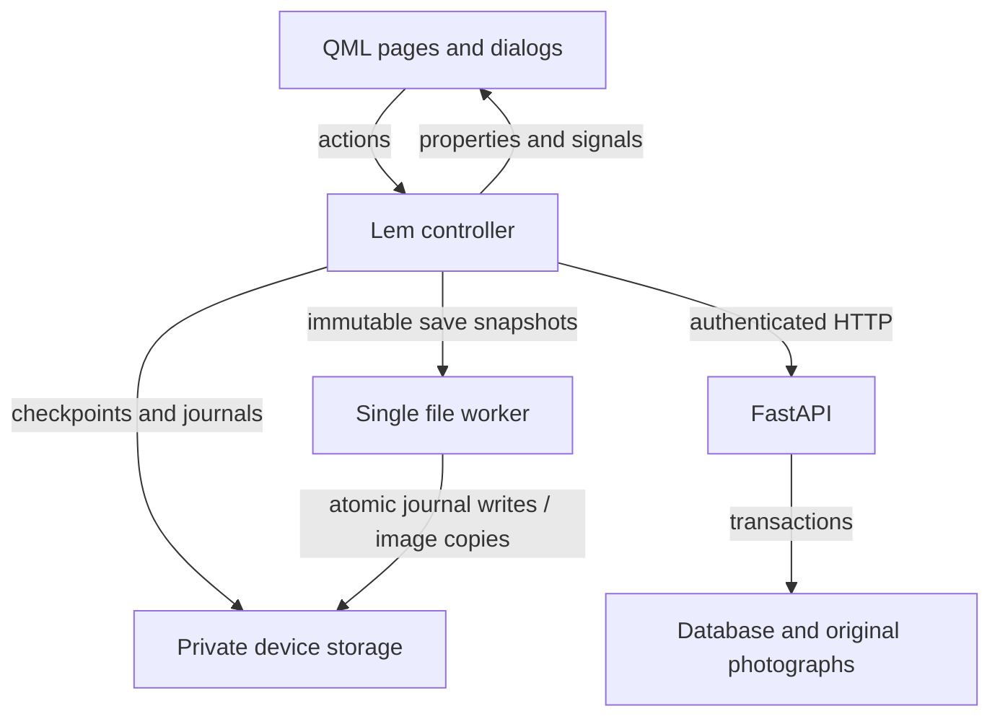

# Architecture and source map

Lem is a Qt Quick client with a C++ application controller, an offline JSON/image
cache and a FastAPI service. PostgreSQL is the deployed database; SQLite is used
for lightweight development and automated API tests.

## Responsibility boundaries

**QML owns presentation.** It holds the selected page/group, scroll positions,
optional observation visibility and confirmation-dialog context. It can show local
validation guidance but cannot authorize a server write.

**`Lem` owns client state and actions.** It decides when to journal, checkpoint,
refresh, send, download or clean data. `Lem.cpp` and `LemOffline.cpp` are two
implementation files for the same class, not two services. Network callbacks and
state changes run on the controller's QObject thread. File workers receive copies;
they must not mutate `m_reports`, `m_current` or QML objects directly.

**The API owns authoritative authorization and concurrency.** Contract access,
current ownership, revisions, closure validation and deletion markers are checked
on the server. Disabling a client button is helpful feedback, not a security boundary.

**The database owns remote persistence.** Original photographs are binary rows,
not paths on a user's phone. Report snapshots and checklist copies make exports
independent of later changes to charger imports or the shared checklist.

## File-by-file map

| File | Responsibility / useful entry points |
| --- | --- |
| [app/src/main.cpp](../../../App/app/src/main.cpp) | Set TLS suffix, style/identity, resolve storage, expose `lem`, load QML; smoke/screenshot flags. |
| [app/src/Lem.h](../../../App/app/src/Lem.h) | QML property/action contract and controller state declarations. |
| [app/src/Lem.cpp](../../../App/app/src/Lem.cpp) | Session/catalogue actions, report editing, camera bridge, HTTP helpers, import/export and progress. |
| [app/src/LemOffline.cpp](../../../App/app/src/LemOffline.cpp) | Journal writer, synchronization, metadata refresh, image download/eviction and conflict recovery. |
| [app/src/AppStorage.h](../../../App/app/src/AppStorage.h) | Copy-based migration from legacy application storage and settings. |
| [app/src/Theme.h](../../../App/app/src/Theme.h) | Explicit light palette across active/inactive/disabled native window roles. |
| [app/qml/Main.qml](../../../App/app/qml/Main.qml) | Shared controls, report tabs, review/status/account dialogs and catalogue/admin pages. |
| [app/android/src/pt/lem/app/CaptureActivity.java](../../../App/app/android/src/pt/lem/app/CaptureActivity.java) | Delegate to installed camera, preserve Activity state, deliver file mailbox result. |
| [app/cmake/AndroidOpenSSL.cmake](../../../App/app/cmake/AndroidOpenSSL.cmake) | Select/validate/package Android OpenSSL libraries for every selected ABI. |
| [shared/checklist-v1.json](../../shared/checklist-v1.json) | Shared question IDs, labels, kinds and photographic evidence requirements. |
| [server/app/main.py](../../../Server/server/app/main.py) | FastAPI composition root, dependencies, routes and mutation transactions. |
| [server/app/models.py](../../../Server/server/app/models.py) | SQLAlchemy schema and database/session creation. |
| [server/app/security.py](../../../Server/server/app/security.py) | Salted password derivation, verification and random-token digests. |
| [server/app/importer.py](../../../Server/server/app/importer.py) | Bounded Excel reader, preview/parser and row/cell validation. |
| [server/app/import_profiles.py](../../../Server/server/app/import_profiles.py) | Fixed Stations layout, field dictionary and recommended mapping detection. |
| [server/app/pdf_report.py](../../../Server/server/app/pdf_report.py) | PDF layout, Lisbon dates, numbered pages and resized image renditions. |
| [deploy/](../../deploy/) | Linux/Windows packaging and SSH deployment, server bootstrap/configuration and backup. |

## Typical requests through the layers

An **OK/NOK/NA tap** calls `lem.answer()`. C++ changes the current report and
its collection entry, increments `_edit_seq` and queues a small journal. It emits
presentation feedback without waiting for a full-cache write or an HTTP round trip.

A **group change** calls `reportSyncBoundary()`. This releases deferred photographs
and schedules sending. The technician can keep entering data while callbacks
reconcile earlier snapshots.

A **report opening** uses the cache first. A first remote opening requests report
metadata only; photographs remain lazy until explicitly downloaded. A **server
export** can render the selected local snapshot with Qt Gui (`ReportPdf.cpp`), including local changes and cached evidence, without a token. Missing local originals require the authenticated server fallback for clean reports. ZIP export still uses the server.

An **ownership transfer** starts in an administrator confirmation dialog, sends the
current revision, and is committed by the server with a revision increase and history
row. An offline device discovers the change during reconciliation, not through an
always-on locking connection.

`Checklist.h` corrects six voltage labels for presentation/export without modifying frozen snapshots. `ReportPdf.cpp` streams text and resized images into paginated A4 PDFs on the existing worker pool, then saves atomically for filesystem destinations.
